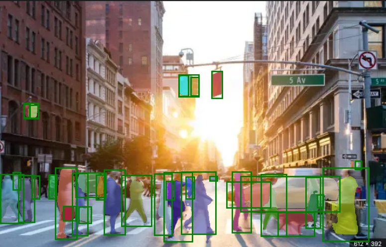

# Tiny YOLO SAM

A lightweight instance-segmentation pipeline that chains **YOLOv12** (object detection) with **TinySAM** (a distilled Segment Anything model): YOLOv12 proposes boxes, and TinySAM turns each box into a mask via box + center-point prompting. Also includes a zero-shot evaluation script against COCO's instance segmentation benchmark.

## Project structure

```
Tiny_YOLO_SAM/
├── scripts/
│   ├── yolo_tinySam_predict.py    # run the pipeline on a single image
│   └── yolo_tinySam_evaluate.py   # zero-shot COCO instance segmentation eval
├── Yolov12/                       # vendored YOLOv12 detector (ultralytics fork)
├── TinySAM/                       # vendored TinySAM segmentation model
├── checkpoints/                   # model weights (see below)
├── dataset/                       # datasets (see below)
├── figs/                          # sample images
└── outputs/                       # generated bbox/result JSON files
```

`Yolov12/` and `TinySAM/` are vendored (not pip packages) because both are customized forks — mainline `ultralytics` and `segment-anything` won't work as drop-in replacements.

## Setup

1. **Python dependencies** (this repo uses whatever `torch`/`opencv`/`pycocotools` you already have installed):
   ```bash
   pip install ultralytics-thop  # required by the vendored Yolov12/ultralytics package
   ```
   The vendored `Yolov12/requirements.txt` lists the full dependency set the fork was built against (pinned `torch==2.2.2`, etc.) — only install from it directly if you're setting up a fresh environment, since it will pin/downgrade packages you may already have at newer versions.

2. **GPU vs CPU**: both scripts auto-detect CUDA (`torch.cuda.is_available()`) and fall back to CPU. If you have an NVIDIA GPU but `torch` was installed as a CPU-only build, inference will still run — just much slower (~3s/image on CPU vs a fraction of that on GPU).

## Downloading model checkpoints

Place these in `checkpoints/`:

| Model | File | Download |
|---|---|---|
| YOLOv12x (used by default) | `yolov12x.pt` | https://github.com/sunsmarterjie/yolov12/releases/download/turbo/yolov12x.pt |
| YOLOv12n/s/m/l (optional, smaller/faster) | `yolov12{n,s,m,l}.pt` | https://github.com/sunsmarterjie/yolov12/releases/download/turbo/yolov12{n,s,m,l}.pt |
| TinySAM (vit_t, 42.3 mAP) | `tinysam_42.3.pth` | https://github.com/xinghaochen/TinySAM/releases/download/3.0/tinysam_42.3.pth |

```bash
cd checkpoints
wget https://github.com/sunsmarterjie/yolov12/releases/download/turbo/yolov12x.pt
wget https://github.com/xinghaochen/TinySAM/releases/download/3.0/tinysam_42.3.pth
```

`TinySAM/bbox_tiny_predict.py` also looks for the checkpoint at `TinySAM/weights/tinysam_42.3.pth` by default if no path is passed explicitly — copy or symlink it there too:
```bash
ln -s ../../checkpoints/tinysam_42.3.pth TinySAM/weights/tinysam_42.3.pth
```

## Downloading datasets

`scripts/yolo_tinySam_evaluate.py` evaluates against COCO's **val2017** split. Expected layout (paths are relative to the project root):

```
dataset/coco/
├── images/val2017/*.jpg
└── annotations/instances_val2017.json
```

Download and unpack the official COCO files:

```bash
mkdir -p dataset/coco/images dataset/coco/annotations

# Validation images (~1 GB)
wget http://images.cocodataset.org/zips/val2017.zip -O /tmp/val2017.zip
unzip /tmp/val2017.zip -d dataset/coco/images

# Instance annotations (~240 MB download, includes val2017 + train2017 annotations)
wget http://images.cocodataset.org/annotations/annotations_trainval2017.zip -O /tmp/annotations_trainval2017.zip
unzip /tmp/annotations_trainval2017.zip -d dataset/coco
```

If you already have a COCO dataset stored elsewhere on disk, symlink it in instead of copying (the full dataset is 50+ GB with train2017 included):
```bash
ln -s /path/to/existing/coco dataset/coco
```

## Usage

**Run the detect + segment pipeline on one image:**
```bash
python scripts/yolo_tinySam_predict.py --image_path figs/demo.png
```
`--image_path` defaults to `figs/demo.png` if omitted. Output visualization is saved to `full_segmented.png`.

**Run zero-shot COCO evaluation:**
```bash
python scripts/yolo_tinySam_evaluate.py
```
This generates YOLOv12 boxes for the val2017 set (cached to `outputs/coco_bboxes.json`), segments each box with TinySAM, and reports COCO segmentation AP/AR via `pycocotools`. Set `max_count` in the script's `__main__` block to a small number (e.g. 10) for a quick smoke test before running the full 5000-image evaluation.

## Example outputs

**`full_segmented.png`** — output of `scripts/yolo_tinySam_predict.py`: YOLOv12 boxes (green) with each detection's TinySAM mask overlaid.



**`test_everything.png`** — output of TinySAM's own "segment everything" demo (`TinySAM/demo_hierachical_everything.py`, run on `TinySAM/fig/picture2.jpg`), which segments the whole image with `SamHierarchicalMaskGenerator` instead of YOLO boxes:
```bash
cd TinySAM
python demo_hierachical_everything.py
```


## Credits

- [YOLOv12](https://github.com/sunsmarterjie/yolov12) — Tian et al.
- [TinySAM](https://github.com/xinghaochen/TinySAM) — Shu et al.
